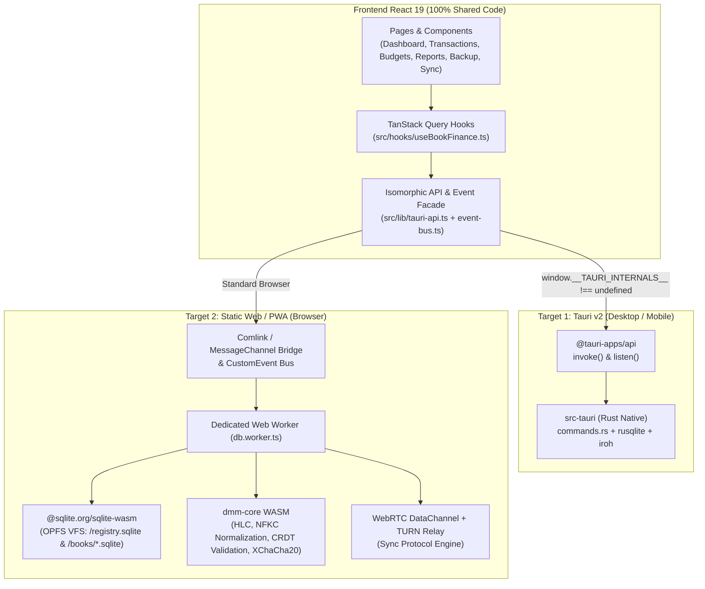

# Rencana Arsitektur & Implementasi: Pure Serverless WebApp (Dual-Target Tauri + Browser)

Dokumen ini mendefinisikan cetak biru teknis untuk memperluas **Decentralize Money Manager** agar dapat berjalan sebagai **Pure Serverless / Static Web Application (PWA)** di samping aplikasi Desktop/Mobile **Tauri v2**, **tanpa migrasi total** (mempertahankan 100% komponen UI React, skema SQLite, aturan bisnis akuntansi, serta protokol sinkronisasi CRDT/HLC).

---

## 0. Ringkasan Prinsip Arsitektur Dual-Target

1. **Zero Backend Database (100% Data di Perangkat Pengguna)**
   - **Mode Tauri (Desktop/Mobile):** SQLite berjalan via `rusqlite` di atas filesystem OS (`$APP_DATA/registry.sqlite` & `$APP_DATA/books/{book_id}.sqlite`).
   - **Mode Web (Browser/PWA):** SQLite berjalan di dalam Web Worker menggunakan `@sqlite.org/sqlite-wasm` di atas **OPFS (Origin Private File System)** dengan struktur tabel dan query SQL yang 100% identik.
2. **Satu Sumber Kebenaran Logika Inti (CRDT, HLC, Normalisasi, Kriptografi)**
   - Modul inti Rust (`hlc.rs`, `crdt.rs`, `sync/crypto.rs`, `sync/protocol.rs`) dikompilasi ke **WebAssembly (`wasm32-unknown-unknown`)** atau diekstrak menjadi crate `dmm-core` yang dipakai bersama oleh `src-tauri` dan Web Worker.
3. **Isomorphic API & Event Layer di Frontend**
   - Komponen UI (`src/components/**`) dan route (`src/routes/**`) tidak perlu tahu apakah aplikasi sedang berjalan di Tauri atau di Browser.
   - `src/lib/tauri-api.ts` dan listener event di `src/hooks/useBookFinance.ts` mendeteksi environment saat runtime (`isTauriRuntime()`) dan memilih adapter yang sesuai (`TauriAdapter` vs `WebWorkerAdapter`).
4. **P2P Sync Lintas Browser dengan WebRTC + TURN Relay**
   - Karena browser tidak mengizinkan raw UDP/QUIC socket (`iroh`), mode Web menggunakan **WebRTC `RTCDataChannel`** yang mengimplementasikan abstraksi `PeerSession` / `Transport` yang sama (pengiriman frame biner maks. 512 KiB).
   - **STUN + TURN Relay Server** (seperti Metered.ca atau self-hosted `coturn`) menjamin tingkat keberhasilan koneksi hingga 99,9% menembus Symmetric NAT / CGNAT (seluler & WiFi), dengan data tetap terenkripsi end-to-end (DTLS + XChaCha20-Poly1305 aplikasi).



---

## LANGKAH 1: Database SQLite di Browser (SQLite WASM + OPFS) & Abstraksi API

Tujuan Langkah 1 adalah membuat seluruh fitur CRUD buku, akun, kategori, transaksi, transfer antar-buku, anggaran (budget), laporan bulanan, dan ekspor/impor backup terenkripsi berjalan **100% offline di browser** tanpa server.

### 1.1 Persyaratan Header HTTP untuk OPFS (`COOP` & `COEP`)

Agar `@sqlite.org/sqlite-wasm` dapat menggunakan `opfs` Virtual File System (VFS) yang persisten dan cepat di dalam Web Worker, server statis dan dev server Vite wajib mengirimkan header isolasi lintas-origin:

```http
Cross-Origin-Opener-Policy: same-origin
Cross-Origin-Embedder-Policy: require-corp
```

- **Di `vite.config.ts`:** Tambahkan header tersebut pada `server.headers` dan `preview.headers`, serta kecualikan `@sqlite.org/sqlite-wasm` dari `optimizeDeps.exclude`.
- **Di Hosting Statis (Cloudflare Pages / Vercel / Netlify):** Tambahkan file `public/_headers` atau `vercel.json` yang menyertakan kedua header di atas.
- **Fallback IndexedDB / `opfs-sahpool`:** Gunakan `opfs-sahpool` VFS (`installOpfsSAHPoolVfs`) sebagai pilihan utama di SQLite WASM karena **tidak mewajibkan** header `COOP/COEP` (`SharedArrayBuffer`), sehingga jauh lebih kompatibel di semua browser modern (Chrome, Edge, Firefox, Safari iOS 17+) dan tidak memblokir resource pihak ketiga.

### 1.2 Struktur Penyimpanan OPFS di Browser

Di dalam `opfs-sahpool` (atau `opfs`), struktur direktori virtual disamakan dengan versi Tauri:
- `/registry.sqlite`: Menyimpan tabel `books (id, name, kind, created_at, last_opened_at)`.
- `/books/{book_id}.sqlite`: Satu database terpisah per buku dengan skema tabel yang identik (`meta`, `accounts`, `categories`, `transactions`, `budgets`, `crdt_oplog`, `sync_peers`).
- `/keystore/{book_id}.key`: Kunci simetris 32-byte per buku (atau disimpan di tabel lokal `registry.sqlite` / IndexedDB keystore).

### 1.3 Ekstraksi Logika Murni Rust ke WASM (`dmm-core` / Web Worker)

Agar aturan di [prompt-decentralize-money-manager.md](file:///c:/dev/p2p-money-manager/docs/prompt-decentralize-money-manager.md) tetap terjaga satu sumber kebenarannya (terutama HLC, normalisasi nama kategori NFKC, deterministik UUIDv5 budget, dan enkripsi backup XChaCha20-Poly1305 + Argon2id):

1. **Fungsi yang dikompilasi ke WASM (`wasm-bindgen`):**
   - `hlc_now_or_tick(last_hlc: Option<String>, physical_ms: u64, device_id: &str) -> String` (dari [hlc.rs](file:///c:/dev/p2p-money-manager/src-tauri/src/hlc.rs))
   - `normalize_category_name(name: &str) -> String` (Unicode NFKC $\rightarrow$ lowercase $\rightarrow$ alphanumeric dari [db.rs](file:///c:/dev/p2p-money-manager/src-tauri/src/db.rs))
   - `deterministic_budget_id(category_id: Option<String>, period: &str) -> String` (UUIDv5 dari [db.rs](file:///c:/dev/p2p-money-manager/src-tauri/src/db.rs))
   - `encrypt_book_backup(sqlite_bytes: &[u8], passphrase: &str) -> Vec<u8>` & `decrypt_book_backup(enc_bytes: &[u8], passphrase: &str) -> Vec<u8>`
2. **Eksekusi SQL di Web Worker (`src/web-worker/db.worker.ts`):**
   - Seluruh command di [commands.rs](file:///c:/dev/p2p-money-manager/src-tauri/src/commands.rs) (`list_books`, `create_book`, `list_accounts`, `upsert_account`, `add_transaction`, `get_monthly_report`, dll.) dijalankan di dalam **Dedicated Web Worker** agar thread utama UI tidak pernah terblokir (setara dengan `tokio::task::spawn_blocking` di Rust).
   - SQL CTE rekursif untuk resolusi penggabungan akun (`ACCOUNT_ROOTS_CTE_SQL` di [crdt.rs](file:///c:/dev/p2p-money-manager/src-tauri/src/crdt.rs)) dan kalkulasi laporan bulanan dijalankan mentah-mentah di SQLite WASM karena mesin SQLite-nya sama persis (SQLite 3.45+).

### 1.4 Perubahan pada Frontend (`Ditambah`, `Diubah`, `Dikurang`)

#### A. File yang DITAMBAH:
1. `src/lib/platform.ts`:
   ```ts
   export function isTauriRuntime(): boolean {
     return typeof window !== "undefined" && "__TAURI_INTERNALS__" in window;
   }
   ```
2. `src/lib/event-bus.ts`:
   - Abstraksi pengganti `@tauri-apps/api/event::listen`.
   - Jika `isTauriRuntime() === true`, panggil `listen()` bawaan Tauri.
   - Jika di Web Browser, gunakan `EventTarget` / `CustomEvent` yang dipancarkan saat Web Worker selesai melakukan commit batch CRDT (`crdt:synced`) atau perubahan status koneksi (`sync:status`).
3. `src/web-worker/db.worker.ts` & `src/lib/web-api-adapter.ts`:
   - Mengelola pool koneksi `sqlite3.oo1.OpfsDb` per `book_id`.
   - Menyediakan handler untuk semua method di `tauriApi`.

#### B. File yang DIUBAH:
1. [src/lib/tauri-api.ts](file:///c:/dev/p2p-money-manager/src/lib/tauri-api.ts):
   - Ubah fungsi internal `callCommand<T>(cmd, args)`:
     ```ts
     async function callCommand<T>(
       cmd: string,
       args?: Record<string, unknown>
     ): Promise<T> {
       try {
         if (isTauriRuntime()) {
           return await invoke<T>(cmd, args);
         }
         return await callWebWorkerCommand<T>(cmd, args);
       } catch (err: unknown) {
         throw normalizeError(err);
       }
     }
     ```
2. [src/hooks/useBookFinance.ts](file:///c:/dev/p2p-money-manager/src/hooks/useBookFinance.ts):
   - Ganti `import { listen } from "@tauri-apps/api/event"` dengan `import { listenAppEvent } from "../lib/event-bus"`.
3. [src/components/backup/BackupPage.tsx](file:///c:/dev/p2p-money-manager/src/components/backup/BackupPage.tsx):
   - Jika `!isTauriRuntime()`, sembunyikan input text `destinationPath` lokal dan ubah aksi tombol menjadi **Download File Backup (`.fmm.enc`)** langsung melalui `Blob` + `<a download>`, serta tambahkan tombol **Restore / Import File Backup** via `<input type="file" accept=".enc,.fmm.enc">`.

### 1.5 Cara Menguji Langkah 1 (Kriteria Selesai)
1. Jalankan `pnpm dev` dan buka `http://localhost:1420` di browser biasa (Chrome/Firefox/Edge) **tanpa** membuka window Tauri.
2. Buat buku baru, tambahkan akun, kategori, transaksi, transfer antar-buku, dan budget.
3. Refresh halaman browser (`F5`) atau tutup dan buka kembali tab $\rightarrow$ pastikan semua data tetap tersimpan utuh di OPFS.
4. Ekspor backup terenkripsi $\rightarrow$ file `.fmm.enc` terunduh di browser.
5. Semua unit test `pnpm test` tetap hijau, dan `pnpm tauri dev` di desktop tetap berfungsi normal.

---

## LANGKAH 2: Infrastruktur Signaling & STUN/TURN Relay Server

Tujuan Langkah 2 adalah menyiapkan jalur perkenalan (Signaling) dan jalur penembus NAT/Firewall (STUN/TURN) agar dua perangkat di jaringan berbeda (misal HP dengan jaringan seluler 4G/5G CGNAT dan Laptop dengan WiFi rumah/kantor) dapat terhubung 99,9% secara real-time dengan biaya $0 (free tier) hingga beberapa dolar per bulan.

### 2.1 Arsitektur Keamanan & Privasi pada TURN dan Signaling

```mermaid
sequenceDiagram
    participant PeerA as Perangkat A (Pengundang)
    participant Sig as Signaling Worker (Stateless / Ephemeral)
    participant Turn as STUN / TURN Server (Metered / Coturn)
    participant PeerB as Perangkat B (Pen-scan QR)

    Note over PeerA,PeerB: 1. Pembuatan Undangan (QR Code / Invite Code)
    PeerA->>PeerA: Generate Ephemeral Room ID + Book Key + Invite Token (HMAC)
    PeerA->>Sig: Buka WebSocket wss://signal.../room/{room_id}
    PeerA->>PeerB: Tampilkan QR Code (berisi room_id, node_id, book_key_encrypted, expires_at)

    Note over PeerA,PeerB: 2. Pertukaran WebRTC SDP & ICE Candidate
    PeerB->>PeerB: Scan QR / Paste Invite JSON
    PeerB->>Sig: Join wss://signal.../room/{room_id}
    PeerB->>Sig: Kirim SDP Offer + ICE Candidates
    Sig->>PeerA: Teruskan SDP Offer + ICE Candidates
    PeerA->>Sig: Kirim SDP Answer + ICE Candidates
    Sig->>PeerB: Teruskan SDP Answer + ICE Candidates
    Note over Sig: Signaling selesai, WebSocket ditutup (0 data disimpan)

    Note over PeerA,PeerB: 3. Koneksi DataChannel (P2P Langsung atau via TURN)
    PeerA<-->Turn: Alokasi Relay (jika Direct P2P gagal karena Symmetric NAT)
    PeerB<-->Turn: Koneksi DTLS Encrypted DataChannel
    Note over PeerA,PeerB: 4. Handshake & CRDT Sync (XChaCha20-Poly1305 di atas DTLS)
    PeerA<-->PeerB: Pertukaran Frame Sync (Hello -> Vector Clock -> OpLog Batch)
```

- **Zero-Knowledge pada Signaling:** Server signaling hanya meneruskan paket SDP (alamat IP/port kandidat) di memori selama proses jabat tangan (~3–5 detik) dan **tidak pernah** menerima `book_key` maupun data transaksi. `book_key` hanya berpindah melalui payload QR Code (atau dienkripsi dengan token undangan).
- **Double Encryption pada TURN:**
  1. Lapisan 1: **WebRTC DTLS** (bawaan wajib browser).
  2. Lapisan 2: **XChaCha20-Poly1305** menggunakan `book_key` 32-byte dari modul [sync/crypto.rs](file:///c:/dev/p2p-money-manager/src-tauri/src/sync/crypto.rs).
  - Server TURN sama sekali tidak dapat membaca isi paket maupun mengetahui buku apa yang sedang disinkronkan.

### 2.2 Konfigurasi STUN & TURN Server

Aplikasi mendukung konfigurasi ICE Server melalui environment variable Vite (`VITE_ICE_SERVERS_JSON` atau kredensial dinamis):

#### Opsi A: Managed Free Tier (Metered.ca / Cloudflare Realtime) — *Rekomendasi Awal ($0)*
- Daftar di **Metered.ca** (mendapatkan kuota gratis **50 GB/bulan**, cukup untuk ~1 juta sinkronisasi transaksi).
- Format konfigurasi di `.env`:
  ```env
  VITE_SIGNALING_URL="wss://dmm-signal.your-domain.workers.dev"
  VITE_TURN_URLS="turn:standard.relay.metered.ca:80,turn:standard.relay.metered.ca:443,turns:standard.relay.metered.ca:443?transport=tcp"
  VITE_TURN_USERNAME="your_metered_username"
  VITE_TURN_CREDENTIAL="your_metered_password"
  ```

#### Opsi B: Self-Hosted `coturn` di VPS Murah ($3.5–$5/bulan)
Jika ingin 100% dikelola sendiri di VPS (Ubuntu/Debian), gunakan konfigurasi `/etc/turnserver.conf` berikut:
```ini
listening-port=3478
tls-listening-port=5349
fingerprint
lt-cred-mech
use-auth-secret
static-auth-secret=GANTI_DENGAN_RAHASIA_32_BYTE_ANDA
realm=sync.yourdomain.com
total-quota=100
stale-nonce=600
no-loopback-peers
no-multicast-peers
```

### 2.3 Implementasi Lightweight Signaling Server (Cloudflare Worker + Durable Objects / Node.js)

Tambahkan folder `signaling-server/` di repositori (kurang dari 100 baris TypeScript) yang menyediakan endpoint WebSocket `/ws/:roomId`:
- Maksimal 2 koneksi per `roomId`.
- Begitu pesan diterima dari koneksi 1, langsung diteruskan (`socket.send()`) ke koneksi 2 di room yang sama.
- Room otomatis dihancurkan setelah 5 menit (TTL sesuai `create_invite`).

### 2.4 Cara Menguji Langkah 2 (Kriteria Selesai)
1. Buka halaman pengujian ICE Trickle atau jalankan fungsi diagnostik `checkTurnConnectivity()` di aplikasi.
2. Pastikan kandidat tipe `srflx` (STUN) dan `relay` (TURN) berhasil dikumpulkan (`onicecandidate`).
3. Uji koneksi WebSocket ke `VITE_SIGNALING_URL` dari dua tab browser berbeda dengan `roomId` yang sama dan pastikan pesan JSON dapat saling terkirim.

---

## LANGKAH 3: Implementasi WebRTC DataChannel & Integrasi Protokol CRDT Sync

Tujuan Langkah 3 adalah menghubungkan pipa **WebRTC `RTCDataChannel`** dengan mesin protokol sinkronisasi CRDT yang sudah ada ([sync/transport.rs](file:///c:/dev/p2p-money-manager/src-tauri/src/sync/transport.rs) dan [sync/protocol.rs](file:///c:/dev/p2p-money-manager/src-tauri/src/sync/protocol.rs)).

### 3.1 Pemetaan `RTCDataChannel` ke Abstraksi `PeerSession` & `Transport`

Di [src-tauri/src/sync/transport.rs](file:///c:/dev/p2p-money-manager/src-tauri/src/sync/transport.rs), protokol sinkronisasi Anda sudah diabstraksikan dengan sangat bersih:
- `MAX_WIRE_FRAME_BYTES = 512 * 1024` (512 KiB).
- `PeerSession` hanya membutuhkan:
  - `remote_node_id(&self) -> &str`
  - `send_frame(&self, data: &[u8])`
  - `recv_frame(&self) -> Vec<u8>`
  - `close(&self)`

Di WebRTC, satu pesan `RTCDataChannel` pada browser modern memiliki batas ukuran pesan aman (*maxMessageSize*) sekitar **64 KiB – 256 KiB** (tergantung implementasi SCTP browser). Oleh karena itu, `WebRtcTransport` menerapkan **Chunking / Framing Layer tipis**:

1. **Konfigurasi DataChannel:**
   ```ts
   const dataChannel = peerConnection.createDataChannel("fmm-sync-1", {
     ordered: true, // Wajib berurutan seperti stream QUIC di Iroh
   });
   dataChannel.binaryType = "arraybuffer";
   ```
2. **Framing & Chunking (32 KiB per chunk SCTP):**
   - Setiap frame protokol (hingga 512 KiB) diawali header 4-byte `u32` (big-endian) yang menyatakan total panjang byte frame, lalu dipotong menjadi chunk `32 KiB` saat dikirim lewat `dataChannel.send(chunk)`.
   - Sisi penerima menggabungkan kembali buffer (`reassembly buffer`) hingga mencapai panjang `u32` yang dideklarasikan, lalu menyerahkannya ke `recv_frame()`.
   - Pantau `dataChannel.bufferedAmount` (gunakan `bufferedAmountLowThreshold = 65536`) untuk *backpressure* agar antrean SCTP tidak penuh saat menyinkronkan ribuan transaksi.

### 3.2 Kompatibilitas Format QR Invite (`NodeTicketAddr`)

Di [src-tauri/src/sync/transport.rs](file:///c:/dev/p2p-money-manager/src-tauri/src/sync/transport.rs#L15-L20), struktur alamat peer saat ini adalah:
```rust
pub struct NodeTicketAddr {
    pub node_id: String,
    pub relay_url: Option<String>,
    pub direct_addrs: Vec<String>,
}
```
Tanpa perlu mengubah skema database atau struktur JSON QR Code:
- `node_id`: Diisi dengan identitas node publik peer (Ed25519 / hex ID perangkat).
- `relay_url`: Diisi dengan URL Signaling Room WebRTC (contoh: `wss://signal.example.com/room/abc123xyz`).
- `direct_addrs`: Diisi daftar penanda protokol (contoh: `["webrtc:v1"]`).

Dengan cara ini:
- Tabel `sync_peers` di SQLite dan komponen UI [SyncPage.tsx](file:///c:/dev/p2p-money-manager/src/components/sync) / [BookSwitcherPage.tsx](file:///c:/dev/p2p-money-manager/src/components/books/BookSwitcherPage.tsx) **tidak perlu diubah struktur datanya**.

### 3.3 Alur Sinkronisasi Saat Aplikasi Terbuka (Foreground Reconnect)

Selain saat pertama kali pairing via QR (`create_invite` & `join_book_from_invite`), bagaimana dua perangkat yang **sudah pernah berpasangan** melakukan sinkronisasi otomatis saat sama-sama membuka aplikasi?

1. Setiap buku memiliki `topic_id = BLAKE3_keyed(book_key, "fmm-sync-topic-v1")` (32 byte hex) yang hanya diketahui oleh perangkat yang memiliki buku tersebut.
2. Saat buku dibuka (`open_book`), `WebRtcSyncEngine` bergabung ke channel signaling berbasis `topic_id` tersebut: `wss://signal.../topic/{topic_id}`.
3. Ketika perangkat lain yang memiliki buku yang sama sedang online di channel `topic_id` tersebut, keduanya otomatis melakukan negosiasi WebRTC (`Offer`/`Answer`), membuka `RTCDataChannel`, dan menjalankan siklus sinkronisasi CRDT (`sync:status` berubah menjadi `"syncing"` $\rightarrow$ memancarkan `crdt:synced` $\rightarrow$ kembali ke `"idle"`).
4. Ketika tab browser masuk ke background (`document.visibilityState === "hidden"`), panggil `setAppForeground(false)` untuk menutup sesi idle dan menghemat baterai.

### 3.4 Opsional Lanjutan: Sinkronisasi Silang Browser $\leftrightarrow$ Desktop Tauri

Jika Anda ingin pengguna di **Browser HP** dapat melakukan sinkronisasi langsung dengan aplikasi **Desktop Tauri**:
- Karena `Transport` di [src-tauri/src/sync/transport.rs](file:///c:/dev/p2p-money-manager/src-tauri/src/sync/transport.rs) sudah berbentuk `trait Transport`, kita dapat menambahkan implementasi kedua di Rust (misal `WebRtcNativeTransport` menggunakan crate `webrtc` atau membiarkan Tauri Desktop juga membuka koneksi WebRTC lewat WebView/Rust) berdampingan dengan `IrohTransport`.
- Dengan demikian, Desktop Tauri dapat menerima koneksi baik dari sesama Desktop (via `iroh`) maupun dari Web Browser (via `WebRTC + TURN`).

### 3.5 Cara Menguji Langkah 3 (Kriteria Selesai)
1. Buka **Browser A** (misal Chrome di Laptop) dan **Browser B** (misal Safari/Chrome di HP dengan jaringan seluler 4G, bukan WiFi yang sama).
2. Di Browser A: Buat buku *"Kas Keluarga"*, tambahkan 3 transaksi, lalu buka menu **Sync $\rightarrow$ Buat Undangan QR**.
3. Di Browser B: Klik **Gabung Buku dari Undangan**, scan/tempel kode QR dari Browser A.
4. Pastikan:
   - Status sync di kedua browser berubah menjadi `connecting` $\rightarrow$ `syncing` $\rightarrow$ `idle` dengan `peers: 1`.
   - Ketiga transaksi langsung muncul di Browser B tanpa refresh halaman.
5. Tambahkan transaksi baru di Browser B $\rightarrow$ pastikan transaksi tersebut muncul secara real-time (< 1 detik) di Browser A.

---

## Ringkasan Daftar Perubahan File (Checklist Implementasi)

| Tahap | Status | File / Direktori | Deskripsi |
| :--- | :---: | :--- | :--- |
| **Langkah 1** | ➕ Tambah | `src/lib/platform.ts` | Deteksi runtime `isTauriRuntime()` |
| **Langkah 1** | ➕ Tambah | `src/lib/event-bus.ts` | Abstraksi event listener (`listen()` Tauri vs `CustomEvent` Web) |
| **Langkah 1** | ➕ Tambah | `src/web-worker/db.worker.ts` | Worker SQLite WASM (OPFS) + eksekusi query & CRDT lokal |
| **Langkah 1** | ➕ Tambah | `src/lib/web-api-adapter.ts` | Bridge RPC dari thread utama ke `db.worker.ts` |
| **Langkah 1** | 🔄 Ubah | [src/lib/tauri-api.ts](file:///c:/dev/p2p-money-manager/src/lib/tauri-api.ts) | Percabangan `callCommand` ke Tauri atau Web Worker |
| **Langkah 1** | 🔄 Ubah | [src/hooks/useBookFinance.ts](file:///c:/dev/p2p-money-manager/src/hooks/useBookFinance.ts) | Gunakan `event-bus.ts` untuk `crdt:synced` & `sync:status` |
| **Langkah 1** | 🔄 Ubah | [src/components/backup/BackupPage.tsx](file:///c:/dev/p2p-money-manager/src/components/backup/BackupPage.tsx) | Download `.fmm.enc` via Blob & Restore via File Picker di mode Web |
| **Langkah 1** | 🔄 Ubah | [vite.config.ts](file:///c:/dev/p2p-money-manager/vite.config.ts) | Konfigurasi bundling Web Worker & SQLite WASM |
| **Langkah 2** | ➕ Tambah | `signaling-server/` | Stateless WebSocket Signaling Worker (Invite Room & Topic Room) |
| **Langkah 2** | 🔄 Ubah | [.env.example](file:///c:/dev/p2p-money-manager/.env.example) | Variabel `VITE_SIGNALING_URL` dan kredensial `VITE_TURN_*` |
| **Langkah 3** | ➕ Tambah | `src/web-worker/webrtc-transport.ts` | Implementasi `PeerSession` & `Transport` di atas `RTCDataChannel` + Chunking 32 KiB |
| **Langkah 3** | ➕ Tambah | `src/web-worker/sync-engine.ts` | Porting state machine sinkronisasi CRDT (`create_invite`, `join_book`, live push) |

